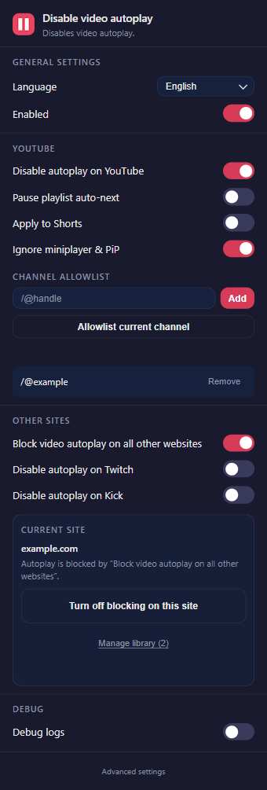
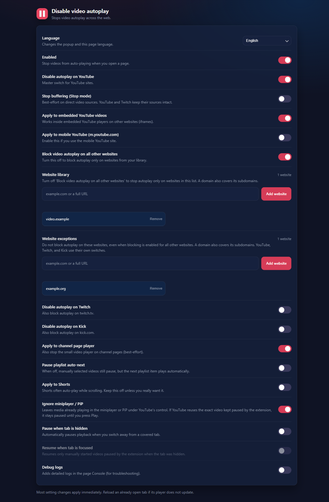

# Disable video autoplay

A Chrome extension that blocks video autoplay on YouTube, Twitch, Kick, and other websites.

## Features

- Separate autoplay switches for YouTube, Twitch, and Kick.
- Block autoplay on other websites globally or only on sites in your library. Add the current site from the popup, or manage the library in settings.
- Exclude individual websites from general blocking. Website rules also cover subdomains; YouTube, Twitch, and Kick use their dedicated switches.
- Allow autoplay for selected YouTube channels, with support for channel handles and channel URLs.
- Configure YouTube Shorts, channel-page players, mobile pages, and embedded videos separately. Miniplayer and picture-in-picture playback can be left alone.
- Allow YouTube playlists to continue automatically while keeping manually selected videos paused, or block playlist auto-next too.
- Use standard pause behavior or an optional stop mode that also attempts to stop buffering. Audio elements are not blocked.
- Optionally pause video when its tab is hidden and resume it when the tab becomes visible again.

The popup provides platform switches and controls for the current website. Advanced settings contain the website library, exceptions, and playback preferences. Settings are saved through Chrome Sync.

Advanced settings and website rules

## Architecture

The extension uses Manifest V3 and two content scripts that run at `document_start`. They have separate responsibilities and execution contexts:

- **ISOLATED world:** `content.js` reads settings, tracks navigation, and resolves website coverage and YouTube channel exceptions using Chrome extension APIs.
- **MAIN world:** `content_main.js` runs in the page's JavaScript context, where it can intercept media `play()` calls and coordinate playback with the site's player controls.

The popup and settings page update `chrome.storage.sync`. The isolated script observes those changes and sends playback configuration and commands to the main-world script through DOM `CustomEvent` messages. Stored website and channel lists stay on the extension side of that bridge.

| Source | Responsibility |
| --- | --- |
| `core/` | Settings normalization, site identity, playback decisions, media classification, and diagnostic sanitization. Rules receive explicit inputs rather than reading browser state. |
| `adapters/` | Browser-facing operations: storage, frame and route context, player-control recognition, media sources, and visibility handling. |
| `content.js`, `content_main.js` | Runtime coordination: navigation, media lifecycle, user input, and communication between execution contexts. |
| `popup.js`, `options.js`, `shared.js`, `ui/` | Settings interfaces, shared rendering, and translations. |
| `background.js` | Toolbar icon updates when the extension's enabled state changes. |

`scripts/build.cjs` packages the source modules into separate, self-contained `dist/main.js` and `dist/content.js` bundles. The manifest loads these bundles in their respective execution contexts, including embedded frames. Shared rules have one source implementation but separate runtime instances in each context.

## License

[MIT](LICENSE).
